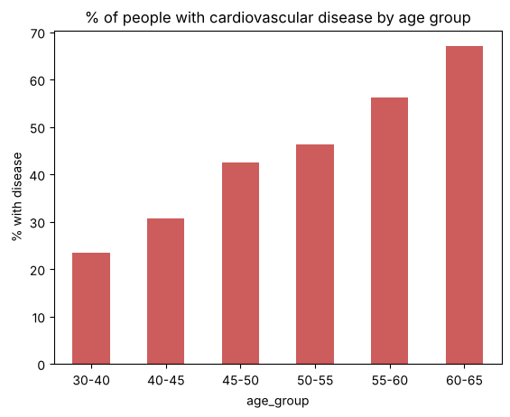
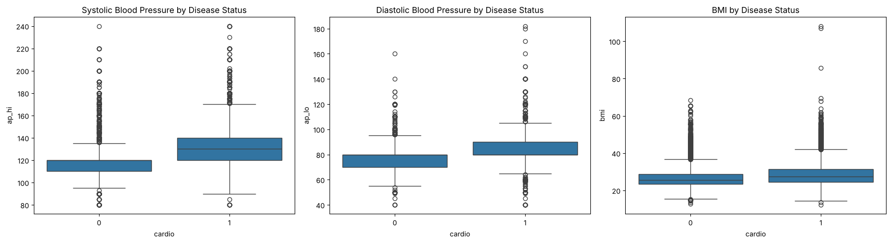
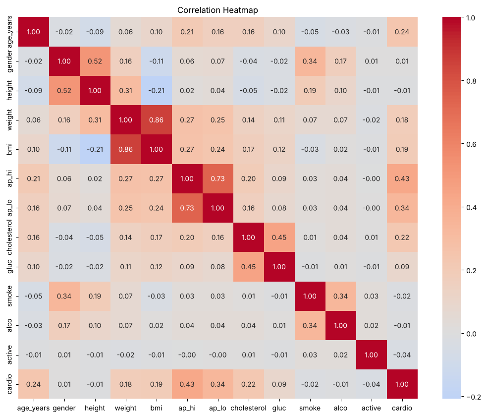
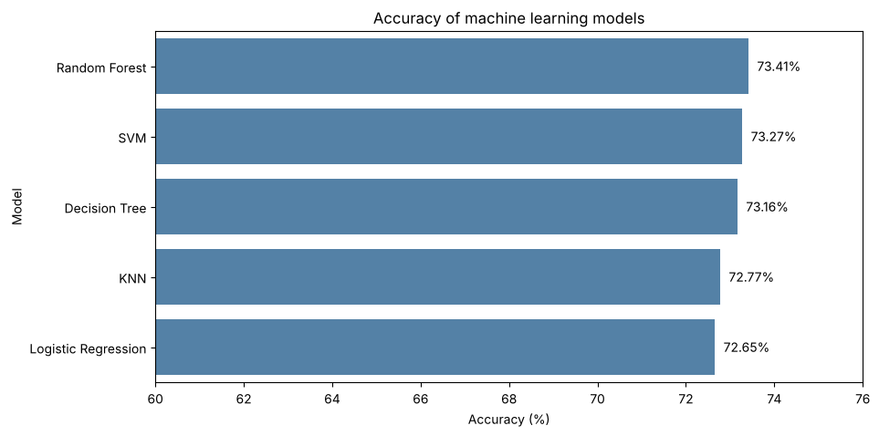
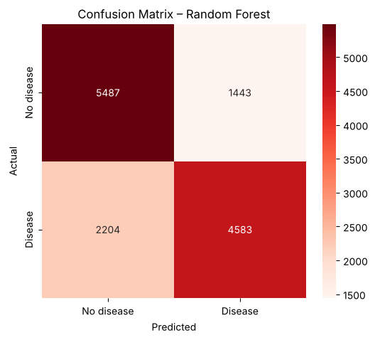
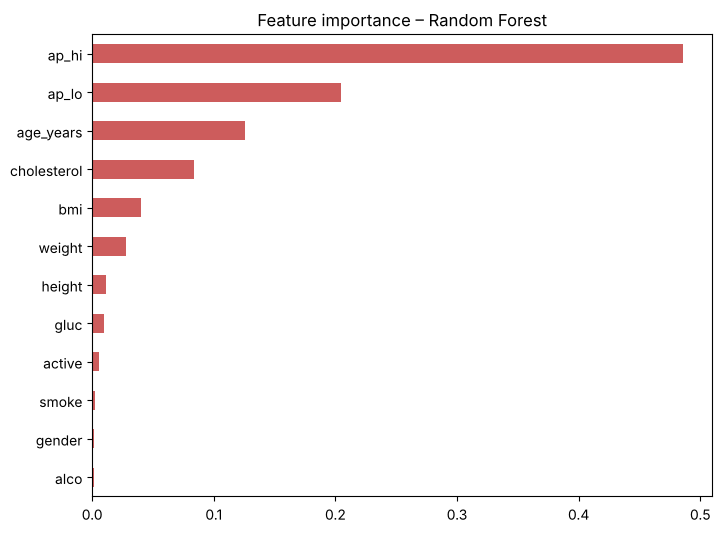

# ❤️ Cardiovascular Disease Prediction


Predicting cardiovascular (heart) disease from patient health records by cleaning and analysing **70,000 records**,
comparing **five machine learning models**, and building a **Random Forest** model for heart disease detection.

📄 **[View the full project report](https://shaletanu.github.io/cardiovascular-disease-prediction/Cardiovascular_Project_Report.html)**  ·
📓 **[Open the notebook](Cardiovascular_Disease_Prediction.ipynb)**

---

## 📌 Objective
Cardiovascular disease is one of the leading causes of death in India and worldwide. This project:
1. Performs data pre-processing
2. Analyses and visualizes the data to find the main risk factors
3. Shows the correlation matrix of the features
4. Compares the accuracy of SVM, KNN, Decision Tree, Logistic Regression and Random Forest
5. Builds the final model for heart disease detection based on the results

## 📂 Dataset
`cardio_data.csv` – 70,000 patients × 13 columns (semicolon-separated)

| Column | Meaning |
|---|---|
| age | age in days (converted to years) |
| gender | 1 = female, 2 = male |
| height, weight | cm, kg |
| ap_hi, ap_lo | systolic / diastolic blood pressure (mmHg) |
| cholesterol, gluc | 1 = normal, 2 = above normal, 3 = well above normal |
| smoke, alco, active | smoker / drinks alcohol / physically active (0 / 1) |
| **cardio** | **target** – cardiovascular disease (0 = no, 1 = yes) |

## 🧹 Data pre-processing
| Step | Rule | Removed |
|---|---|---|
| Duplicates | identical records | 24 |
| Blood pressure | systolic 80–250, diastolic 40–200, systolic > diastolic | 1,333 |
| Height / weight | height 120–220 cm, weight 30–250 kg | 56 |
| BMI | BMI below 12 | 2 |

**68,585** records remain. Added `age_years` and `bmi` (weight ÷ height²).

## 📊 Key insights


- Heart disease rises with **age**: 23.4% of patients aged 30–40 → 67.1% aged 60–65
- **High blood pressure** (140/90+): 78.0% have the disease vs 34.6% with normal blood pressure
- **Cholesterol**: 43.5% (normal) → 76.2% (well above normal)
- **Gender** makes almost no difference (49.2% vs 50.0%)



## 🔗 Correlation matrix


Systolic blood pressure has the strongest link with the disease (**0.43**), followed by diastolic pressure (0.34),
age (0.24), cholesterol (0.22) and BMI (0.19).

## 🤖 Model comparison
80% training / 20% testing, features scaled with `StandardScaler`.

| Model | Accuracy |
|---|---|
| **Random Forest** | **73.41%** |
| SVM | 73.27% |
| Decision Tree | 73.16% |
| KNN (k = 35) | 72.77% |
| Logistic Regression | 72.65% |



## 🌲 Final model: Random Forest
200 trees, max depth 8. **Accuracy 73.41%** · precision for disease 0.76 · recall for disease 0.68

 

Systolic blood pressure, diastolic blood pressure, age and cholesterol drive the predictions.

```python
predict_person(age=58, gender=2, height=172, weight=92, ap_hi=160, ap_lo=100,
               cholesterol=3, gluc=1, smoke=1, alco=0, active=0)
# Cardiovascular disease: YES  (probability 83.5 %)
```

## ▶️ How to run
1. Open `Cardiovascular_Disease_Prediction.ipynb` in [Google Colab](https://colab.research.google.com) (File → Upload notebook)
2. Upload `cardio_data.csv` using the **Files** panel (folder icon on the left)
3. Run all cells (the SVM step takes 2–4 minutes)

## 🗂️ Files
| File | Description |
|---|---|
| `Cardiovascular_Disease_Prediction.ipynb` | Google Colab notebook with code, explanations and outputs |
| `Cardiovascular_Project_Report.html` | Full project report |
| `cardio_data.csv` | Dataset |
| `*.png` | Charts used in this README |

## 🛠️ Tools
Python · pandas · NumPy · Matplotlib · Seaborn · scikit-learn · Google Colab
